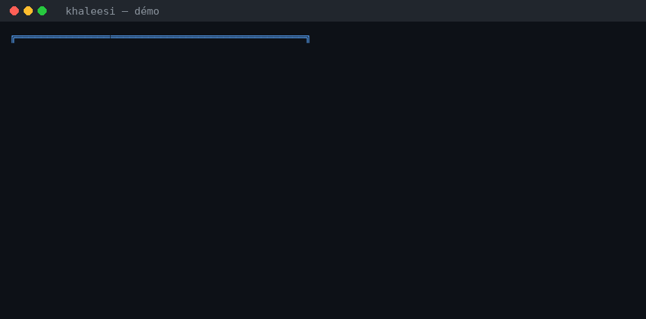

# Khaleesi 🔥 — mère des dragons


Outil de **test de résistance des identifiants** (brute force) sur un endpoint
d'authentification HTTP, destiné aux tests d'intrusion **autorisés**.

> *« Chaque thread est un dragon. Quand un mot de passe faible se présente : Dracarys. »*



> ⚠️ **Avertissement légal** : à utiliser uniquement sur votre propre
> infrastructure ou avec un mandat écrit du propriétaire du système.
> Toute utilisation non autorisée est illégale.

## Fonctionnalités

- Mode **interactif** (l'URL, l'identifiant et le dictionnaire sont demandés) ou **100 % CLI**
- **Multithreading** configurable (`-t`) avec débit affiché (req/s)
- Détection de succès configurable : clé JSON (`--success-key`), code HTTP (`--success-status`) ou texte (`--success-text`)
- Corps de requête personnalisé (`--body-template`, `--field-email`, `--field-password`) : JSON, formulaires, etc.
- Détection de **rate-limiting** : avertit sur les 429/503 et s'arrête après N erreurs consécutives (`--stop-on-errors`)
- Reprise et échantillonnage : `--start-line`, `--max-attempts`
- Proxies (HTTP/SOCKS), en-têtes personnalisés, User-Agent, timeout, TLS non vérifié (`--insecure`)
- **Rapport JSON** (`-o`) : cible, compte, nombre d'essais, durée, résultat
- Codes de retour propres pour l'automatisation (0 succès, 1 échec, 2 erreur d'usage, 3 arrêt anticipé)

## Démo (texte)

```text
╔══════════════════════════════════════════════╗
║      khaleesi v2.0.0 — mère des dragons      ║
╚══════════════════════════════════════════════╝

[INFO] Dico    : wordlist.txt (100 candidats, démarrage ligne 1)
[INFO] Config  : 5 thread(s), timeout 10.0s, délai 0.0s
[INFO] Terminé en 0.18s — 79 requêtes (427.2 req/s), 0 erreur(s).
[OK  ] SUCÈS : mot de passe trouvé 'Dracarys!' (ligne 77, statut HTTP 200, 0.18s)
```

## Installation

```bash
pip install -r requirements.txt
```

## Utilisation

Mode interactif :

```bash
python3 khaleesi.py
```

Mode CLI :

```bash
python3 khaleesi.py \
    -u http://localhost:3000/api/auth/login \
    -e cible@exemple.com \
    -w /usr/share/wordlists/rockyou.txt \
    -t 10 --delay 0.1 -o rapport.json
```

Exemples de détection personnalisée :

```bash
# Clé JSON de succès différente
python3 khaleesi.py -u ... -e ... -w ... --success-key authenticated

# Succès basé sur le code HTTP
python3 khaleesi.py -u ... -e ... -w ... --success-status 200

# Formulaire classique
python3 khaleesi.py -u ... -e ... -w ... \
    --body-template 'login={EMAIL}&pass={PASSWORD}' --success-text 'Bienvenue'
```

## Codes de retour

| Code | Signification |
|------|---------------|
| 0    | Mot de passe trouvé |
| 1    | Dictionnaire épuisé sans succès |
| 2    | Erreur d'utilisation (arguments, fichiers) |
| 3    | Arrêt anticipé (cible injoignable / rate-limiting) |
| 130  | Interruption clavier (Ctrl+C) |

## Licence

MIT
